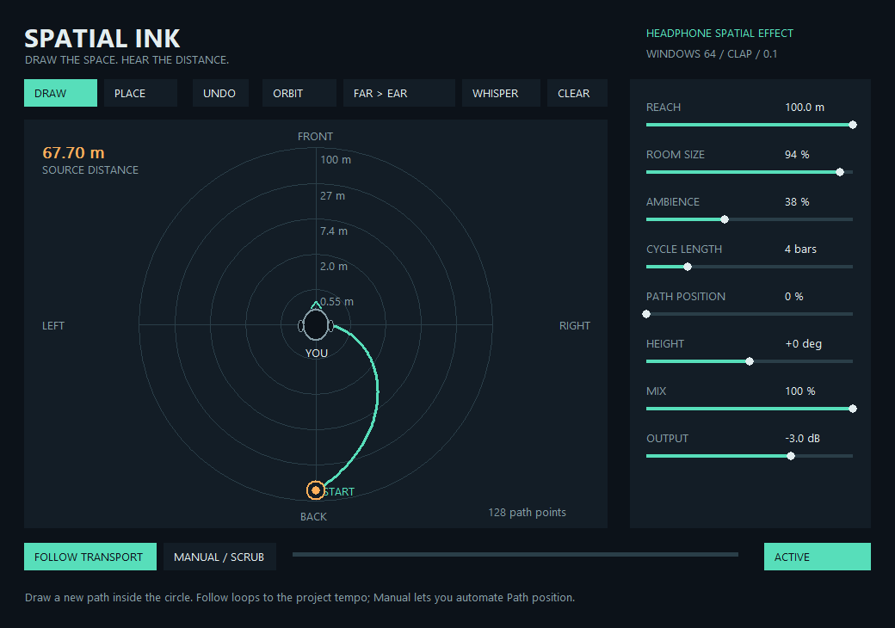

# Spatial Ink

Windows x64 CLAP audio effect with a drawing interface for moving a headphone sound source from distant spaces to close to an ear.

**[الدليل الكامل بالعربي](README-AR.md)**

## Download and install

Download [SpatialInk-Setup.exe](SpatialInk-Setup.exe) using GitHub's **Download raw file** button, close FL Studio, run the installer, approve administrator access and click **تثبيت**.

The installer copies `SpatialInk.clap` to the Windows Common Program Files `CLAP` folder. In FL Studio, open **Options > File settings > Manage plugins**, enable **Verify plugins** and **Rescan previously verified plugins**, then select **Find installed plugins**.

Requires **Windows x64 and FL Studio 2024.1 or newer**, or another compatible CLAP host. Manual installation is also possible using the included [SpatialInk.clap](SpatialInk.clap). See the [Image-Line installation guide](https://www.image-line.com/fl-studio-learning/fl-studio-online-manual/html/basics_externalplugins.htm).

## Features

- Draw a horizontal path or place a stationary source.
- Automatic distance attenuation, direction-dependent filtering, interaural time/level cues and diffuse reverb.
- Artistic source-distance range of approximately 0.15–100 metres; independent room-size and ambience controls.
- Follow the project beat/meter over 1–16 bars, or automate **Path position** manually.
- Orbit, Far > Ear and Whisper presets, Undo, mix/output controls and approximate height coloration.
- Project-state recall, stereo input/output, in-place processing and 32/64-bit samples.
- Offline installer with embedded-payload verification and safe replacement of the plugin file.

The processed signal is a single source derived from a stereo downmix. The dry signal retains the original stereo channels.

## Build and tests

The full plugin source, test host and vendored CLAP headers are in [source/](source/). Build scripts use the portable LLVM-MinGW UCRT x86_64 toolchain.

- [Plugin build instructions](source/BUILD.md)
- [Installer source and build instructions](installer/BUILD.md)
- [Verification report](TEST-REPORT.md)
- [8-second headphone audio demo](Headphone-demo.wav)
- [Prebuilt-file SHA-256 checksums](SHA256SUMS.txt)

The independent CLAP Validator run passed 34 tests with 0 failures and 0 warnings; 10 platform-specific or optional-extension checks were skipped. Integration tests cover drawing, state recall, direction/distance, transport/meter, audio formats and the installer copy routines.

## Current limitations

This is an initial **0.1.0** implementation using analytic binaural cues, **not measured or personalized HRTFs**. Front/back and elevation perception may be less reliable than left/right direction. The displayed distances are artistic controls rather than calibrated acoustical measurements.

The plugin and installer were tested independently; an end-to-end run inside FL Studio itself has not yet been performed. See [TEST-REPORT.md](TEST-REPORT.md) for the exact verification scope.

## License

[MIT](LICENSE.txt). Vendored CLAP headers retain their upstream [MIT license](source/CLAP-LICENSE.txt).
